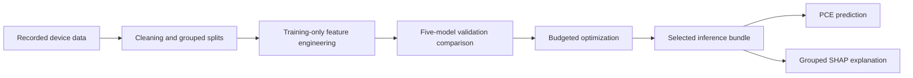
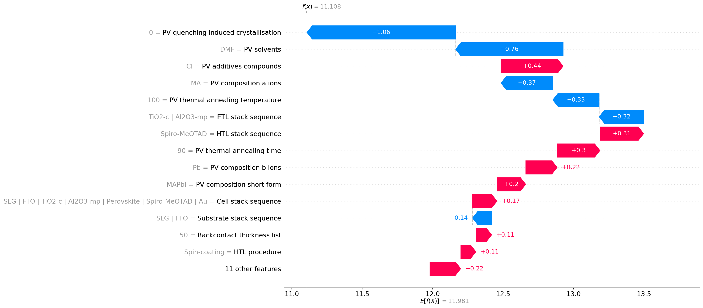

# Solarcell XAI

[](https://solarcellxai.streamlit.app/)
[](https://github.com/Sreeshank/ML-Project/actions/workflows/tests.yml)

**Predict perovskite solar-cell efficiency and explore the inputs behind each estimate.** Solarcell XAI combines an interactive crystal explorer, a materials-and-fabrication prediction studio, and SHAP explanations with a reproducible CPU research pipeline.

**[Launch Solarcell XAI](https://solarcellxai.streamlit.app/)** · [Deployment guide](docs/DEPLOYMENT.md) · [Research notes](docs/RESEARCH.md) · [Contributing](CONTRIBUTING.md)

## What the project does

Power conversion efficiency (PCE) is the percentage of incoming light power converted to electrical power. This project learns relationships between recorded device inputs and PCE, then shows which inputs move a model prediction above or below its base value.

- **Interactive crystal explorer:** drag to rotate, zoom, inspect A/B/X sites, toggle bonds, and reset the view. Keyboard controls and reduced-motion support are included.
- **Prediction studio:** configure 25 recorded material, device-layer, and fabrication inputs, then estimate PCE with the selected LightGBM pipeline.
- **Explainable output:** inspect signed, grouped SHAP contributions and download the submitted inputs and prediction as JSON.
- **Model comparison:** review validation metrics from five algorithms and the budgeted LightGBM/CatBoost optimization runs.
- **Portable inference:** the selected model bundle is included, so app use does not require the original CSV or a training run.

The crystal is an idealized cubic ABX3 illustration. It supports exploration of the structure; it does not simulate the configured solar cell.

## Try the app

1. Open **[solarcellxai.streamlit.app](https://solarcellxai.streamlit.app/)**.
2. Select **Predict & explain** and review the four input modules.
3. Click **Launch prediction** to calculate estimated PCE and SHAP contributions.
4. Read the base-value equation and contribution bars, then export the JSON result if needed.

Results reflect the last submitted configuration. Submit again after changing inputs. The overview and model-comparison tabs explain the dataset and evaluation context.

## Run locally

Use **Python 3.12** with the pinned inference dependencies:

```bash
git clone https://github.com/Sreeshank/ML-Project.git
cd ML-Project
python -m venv .venv
```

Activate the virtual environment:

```powershell
# Windows PowerShell
.venv\Scripts\Activate.ps1
```

```bash
# macOS / Linux
source .venv/bin/activate
```

Install and start:

```bash
python -m pip install -r deploy/requirements.txt
python -m streamlit run app.py
```

Open the local URL printed by Streamlit. Linux environments need `libgomp1` for LightGBM; Community Cloud installs it from `packages.txt`.

The saved inference bundle lives in `models/app_bundle/`. Set `PEROVSKITE_BUNDLE` to use another trusted compatible bundle directory. The app validates the model checksum against its metadata before loading it.

For CLI prediction with the included example input:

```bash
python -m src.predict predict --input models/app_bundle/example_input.json --explain
```

Each input record must contain all 25 expected raw fields. See [input validation and inference details](docs/RESEARCH.md#predict-from-json).

## How it works



The prepared dataset contains **40,482 labeled records** after deduplication and missing-target removal, from **42,443 raw records**. The pipeline retains **25 raw predictors** and adds **252 engineered features**. Identical normalized input configurations stay within a single train, validation, or test partition.

Raw values, recorded units, and missingness are preserved. Feature engineering captures layer counts, chemical-token indicators, and reported measurement summaries. Target PCE and electrical outcomes such as Voc, Jsc, and fill factor are excluded from predictors.

## Recorded validation results

The active optimized pipeline is **`lightgbm_trial_0`**, selected by validation RMSE.

| Metric | Active model validation result |
| --- | ---: |
| MAE | 2.7808 PCE percentage points |
| RMSE | 3.6830 PCE percentage points |
| R2 | 0.4778 |

These results come from [the recorded model-selection artifact](reports/phase4_run_001/selection.json). The optimized model has **no newly computed test score**. Earlier Phase 3 test metrics evaluate the earlier untuned pipeline and are documented separately in the [research notes](docs/RESEARCH.md).

### Example explanation artifact



Saved validation example from the explanation run. The base value plus grouped contributions reconstructs the model prediction; the live app produces an explanation for each submitted configuration.

## Repository map

```text
app.py                         Streamlit interface
assets/                        Styling and interactive crystal renderer
src/                           Preprocessing, training, inference, and explanations
deploy/                        Cloud entrypoint and pinned inference dependencies
models/app_bundle/             Selected model, metadata, and example input
notebooks/                     Five phase notebooks
reports/                       Saved research metrics, audits, and figures
tests/                         Python integration/unit tests and JS interaction tests
docs/RESEARCH.md               Detailed experiment methodology and reproduction
docs/DEPLOYMENT.md             Cloud configuration and troubleshooting
.github/workflows/tests.yml    Automated Python and JavaScript checks
```

The original CSV, processed datasets, and other trained models are excluded by `.gitignore`. The selected app bundle is included for inference. Source-dataset provenance is recorded through SHA256 audits; full training reproduction requires the original source CSV.

## Development and testing

Install the research dependencies with the deployment pins, then run the suites:

```bash
python -m pip install -r requirements.txt -c deploy/requirements.txt
python -m pytest -q
node --test tests/crystal_interactions.test.mjs
```

Node 22 is used for the JavaScript checks; Node is not required to run the app. Python tests cover cleaning, grouping, feature engineering, model serialization, inference validation, SHAP additivity, and both Streamlit entrypoints. The crystal tests exercise rotation, zoom, keyboard controls, motion settings, and animation cleanup.

GitHub Actions runs these suites for pushes to `main` and pull requests. See [contribution instructions](CONTRIBUTING.md) for environment setup and change validation, and the [research notes](docs/RESEARCH.md) for full experiment commands.

## Deploy your own instance

In [Streamlit Community Cloud](https://share.streamlit.io/), select your repository, branch `main`, entrypoint **`deploy/streamlit_app.py`**, and **Python 3.12** in Advanced settings. The app itself requires no API keys or secrets.

See the [deployment guide](docs/DEPLOYMENT.md) for the dependency files, bundle contents, and troubleshooting.

## Interpretation limits

PCE outputs are model estimates and have not been experimentally verified. SHAP describes predictive associations, not causal material effects. Independently combined dropdown choices can form untested or physically inconsistent devices, and bare recorded measurement numbers retain unspecified units.

Repeated validation-based model selection can make validation estimates optimistic. No independent external benchmark or calibrated prediction interval has been established.

## Feedback

Report a reproducible problem using the [bug report form](https://github.com/Sreeshank/ML-Project/issues/new?template=bug_report.yml), or suggest an improvement using the [feature request form](https://github.com/Sreeshank/ML-Project/issues/new?template=feature_request.yml).
